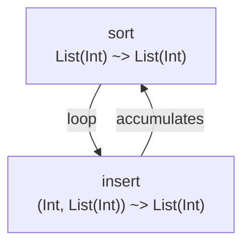

# Arrow Graph Visualizer

## Context

Handl programs are compositions of arrows. A typical program chains multiple arrows through combinators:

```
sort = arr("insert") >>> loop {
  remaining: input,
  acc: []
} (
  []: returnA -< { sorted: state.acc },
  [h, ...t]: do {
    r <- insert -< { elem: h, acc: state.acc };
    returnA -< { state: { remaining: t, acc: r } }
  }
)
```

Reading this source, it's hard to see the data flow: which arrows feed into which, what the loop structure is, where branching happens. Developers need to mentally trace the arrow graph to understand the program.

A visualizer renders this graph as a diagram — nodes are arrows, edges are data flow, annotations show refinement types. This makes the program's structure immediately visible.

### Why now

The LSP server already has the information needed to build the graph:
- **Document symbols** — arrow definitions and their names
- **Call hierarchy** — which arrows call which (incoming/outgoing)
- **Refinement inference** — input/output types and guarantees for each arrow
- **Cross-file references** — arrow references across the workspace

The visualizer is a consumer of this data, not a new analysis engine.

## Decision

Build a standalone visualization tool that renders arrow graphs as SVG diagrams. The tool reads `.hnl` files, extracts the arrow graph using the existing kit infrastructure, and produces an SVG (or Mermaid diagram) showing the data flow.

### Architecture

```
handl visualize [path] [--format svg|mermaid] [--output file]
│
├── Parse all .hnl files under path (using Kit)
├── Extract arrow graph:
│   ├── Nodes: each arrow definition (name, file, refinement type)
│   ├── Edges: arrow references (caller → callee)
│   └── Groups: loop structures, do blocks
├── Layout graph (dagre or simple layered layout)
└── Render: SVG or Mermaid text
```

### Output formats

#### SVG

A standalone SVG file with:
- **Nodes**: rounded rectangles labeled with arrow name + refinement type
- **Edges**: directed arrows showing data flow
- **Colors**: 
  - Blue nodes: arrows defined in the workspace
  - Gray nodes: external/stdlib arrows (e.g., `arr("insert")`)
  - Green edges: sequential composition (`>>>`)
  - Orange edges: arrow application (`-<`)
  - Purple boxes: loop boundaries
- **Tooltips**: hover over a node to see the full refinement contract

#### Mermaid

A Mermaid `graph TD` text representation that can be rendered in GitHub, GitLab, or any Markdown viewer:



Mermaid output is the default — it's text-based, diffable, and renders in any Markdown viewer without a tool.

### CLI interface

```bash
# Visualize all arrows in the workspace
handl visualize

# Visualize a specific arrow and its dependencies
handl visualize arrows/fn/sort.hnl

# Output as SVG
handl visualize --format svg --output graph.svg

# Output as Mermaid (default)
handl visualize --format mermaid

# Show only the call graph (no refinement types)
handl visualize --no-types

# Focus on a specific arrow's neighborhood (callers + callees, depth 2)
handl visualize --focus sort --depth 2
```

### Integration with existing infrastructure

The visualizer uses the same kit loading as the CLI and LSP server:
1. Resolve `.handl.toml` from the target path
2. Load the kit's data files
3. Parse all `.hnl` files under the target path
4. For each file: extract arrow definitions (name, parameters, body)
5. For each arrow body: find references to other arrows (identifiers, string literals in `arr("name")`)
6. Build the graph: nodes from definitions, edges from references
7. Optionally: run refinement inference to annotate nodes with types

No new analysis logic — the visualizer reuses:
- `Kit` for lexing/parsing
- `RefinementEngine` for type annotations (optional, can be skipped with `--no-types`)
- `call_hierarchy` module's reference-finding logic (already implemented)

### Implementation location

New crate: `handl-host-visualize` (a new host that loads kits and produces diagrams).

Alternatively: a new command in `handl-host-cli` (`handl visualize`). This is simpler and avoids a new crate. The command produces Mermaid text (no rendering dependency) or SVG (using a minimal SVG writer — no external dependency).

**Preferred: new command in `handl-host-cli`.** Mermaid output requires no rendering library. SVG output can be generated with a simple string builder (SVG is just XML). No need for a graph layout library if we use Mermaid's built-in layout or a simple top-to-bottom layered layout.

### Layout algorithm

For SVG output, use a simple layered layout:
1. Topological sort arrows by dependency (arrows with no dependencies first)
2. Assign each arrow to a layer (max depth from roots)
3. Position nodes in columns by layer, rows by alphabetical order within a layer
4. Draw edges as bezier curves between node centers

This is ~100 lines of code. No need for `dagre` or other layout libraries.

For Mermaid output, the layout is handled by the Mermaid renderer (GitHub, GitLab, etc.).

## Alternatives Considered

### Alternative A: D3.js web-based visualizer

Build a web app that reads `.hnl` files and renders an interactive D3.js graph.

**Rejected because:**
- Requires a JS/WASM backend to parse handl (doesn't exist yet).
- A web app is a separate deployment concern.
- Mermaid output works in any Markdown viewer and is diffable in git.
- Can be built later as a frontend on top of the CLI tool's Mermaid output.

### Alternative B: Integrate into the LSP server as a custom command

Add a `handl.visualize` custom LSP command that returns graph data as JSON. The editor extension renders it.

**Rejected because:**
- VS Code doesn't have a built-in graph renderer. Would need a webview, which is a separate extension feature.
- A CLI tool produces output that works anywhere (terminal, CI, Markdown).
- The LSP server should stay focused on language features, not visualization.

### Alternative C: Use Graphviz (dot)

Generate Graphviz DOT files and shell out to `dot` for rendering.

**Rejected because:**
- Adds a system dependency (Graphviz must be installed).
- Mermaid is more portable (renders in GitHub/GitLab natively).
- SVG can be generated directly without Graphviz.

## Consequences

### Positive

- **Program structure becomes visible** — developers can see the arrow graph at a glance
- **Mermaid output is diffable** — diagrams live in the repo and update in PRs
- **No external dependencies** — Mermaid is text, SVG is XML, both can be generated with string builders
- **Uses existing analysis** — reuses kit parsing, refinement inference, and call hierarchy logic
- **Works in CI** — `handl visualize --format mermaid` can generate diagrams in docs/CI

### Negative

- **Simple layout may look bad for complex graphs** — the layered layout won't handle cyclic or densely-connected graphs well. Mitigated by Mermaid's built-in layout (for Mermaid output) and the `--focus` flag to limit graph size.
- **No interactivity** — SVG output is static. No clicking to expand/collapse nodes. Mitigated by Mermaid's interactive rendering in web viewers.
- **New CLI command** — adds surface area to `handl-host-cli`. Minimal complexity since it reuses existing modules.

### Neutral

- **No impact on LSP server or editor extensions** — the visualizer is a separate CLI command.

## Status

Proposed
